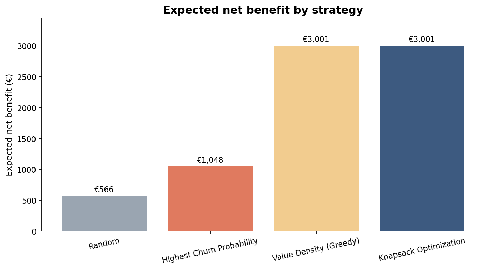
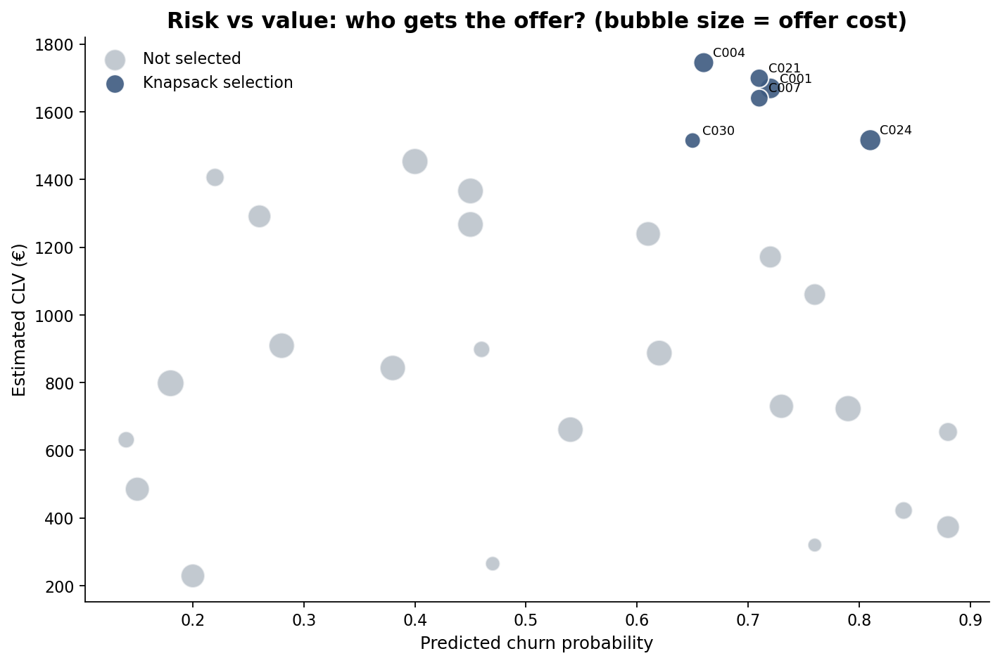
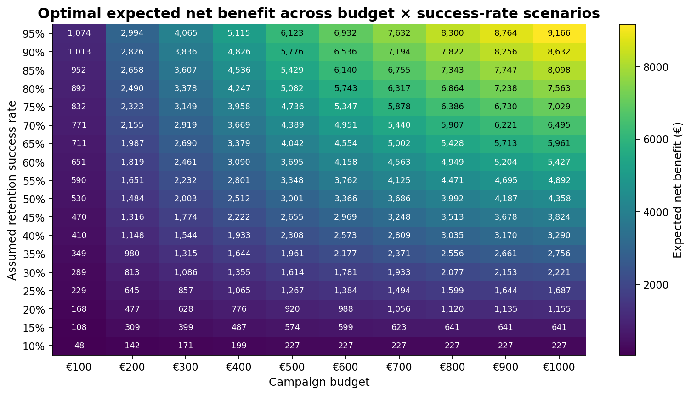
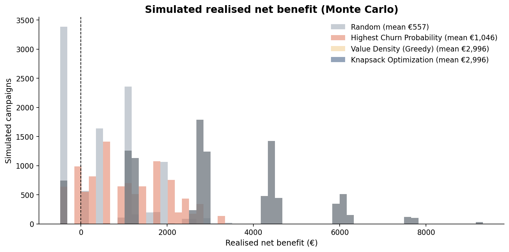

<div align="center">

# Project Odin

### From churn risk to profitable retention decisions

**Which customers should get a retention offer when the budget is limited?**
Project Odin turns churn-risk scores into an optimal campaign by solving a 0/1 Knapsack problem.

[](https://github.com/afroozmohandesian/churn-retention-optimizer/actions/workflows/ci.yml)


</div>

---

## Contents

- [The problem](#the-problem)
- [Key results](#key-results)
- [How it works](#how-it-works)
- [Quick start](#quick-start)
- [Repository structure](#repository-structure)
- [Data](#data)
- [Risk and sensitivity](#risk-and-sensitivity)
- [Testing and verification](#testing-and-verification)
- [Limitations](#limitations)
- [Roadmap](#roadmap)

---

## The problem

A subscription business has a **fixed retention budget** and a list of customers who might cancel. Each retention offer (a discount, a free month, an upgrade) costs money. The usual approach is to contact the customers most likely to churn first.

That rule has three blind spots:

| Blind spot | Why it costs money |
|---|---|
| High-risk ≠ high-value | A customer who is 88% likely to leave but worth €370 may not be worth a €100 offer. |
| Moderate risk can still pay | A customer at 66% risk worth €1,745 may be the best use of the budget. |
| Picking one at a time ≠ best combination | Ranking customers one by one can leave budget unused or fund the wrong mix. |

The real question is not "who is most likely to leave?" but:

> **Which *combination* of customers maximises expected financial benefit without exceeding the budget?**

That is a budget-constrained combinatorial optimisation problem, the classic **0/1 Knapsack**.

---

## Key results

*30-customer reference dataset · €500 budget · 50% assumed offer success rate*

| Strategy | Customers | Spend | Expected net benefit | ROI | % of optimum | P(loss)* |
|---|---:|---:|---:|---:|---:|---:|
| Random (baseline) | 5 | €462 | €566 | 1.23× | 19% | 34% |
| Highest churn probability | 5 | €481 | €1,048 | 2.18× | 35% | 16% |
| Value density (greedy) | 6 | €467 | €3,001 | 6.43× | 100% | 7% |
| **Knapsack optimisation** | **6** | **€467** | **€3,001** | **6.43×** | **100%** | **7%** |

<sub>*Probability that the realised campaign result is negative, from 10,000 Monte Carlo simulations.</sub>

**Takeaways**

- On the same €500 budget, the optimised portfolio is worth **2.9× more than the risk-first rule** and **5.3× more than random selection**.
- The selected customers are **C001, C004, C007, C021, C024, C030**. None of them is the single riskiest customer. They combine moderately high risk with high lifetime value and low offer cost.
- The greedy *value-density* heuristic happens to match the optimum at €500. At other budgets it does not: across budgets from €50 to €1,000 it reaches as little as **91.3%** of the optimum, while the risk-first rule falls to **18.3%** ([`heuristic_gap_by_budget.csv`](outputs/tables/heuristic_gap_by_budget.csv)).
- The solver handles **10,000 customers with a €50,000 budget in under a second** ([`solver_runtime.csv`](outputs/tables/solver_runtime.csv)).

<p align="center">
  
  
</p>

---

## How it works

### 1. Customer economics

For every customer *i*, with assumed offer success rate *r*:

$$
\text{ERV}_i = P_i(\text{churn}) \times \text{CLV}_i \times r
\qquad\qquad
\text{ENB}_i = \text{ERV}_i - C_i
$$

- **ERV** (expected retained value): the value at risk, times the chance the offer prevents the loss.
- **ENB** (expected net benefit): ERV minus the cost of the offer.

*Example:* P = 0.60, CLV = €1,000, r = 50%, cost = €80 → ERV = €300 → **ENB = €220**.

The package also reports each customer's **break-even success rate**, `C / (P × CLV)`: the minimum offer effectiveness at which that offer pays for itself.

### 2. Portfolio optimisation (0/1 Knapsack)

$$
\max_{x}\ \sum_i x_i\,\text{ENB}_i
\quad\text{s.t.}\quad
\sum_i x_i\,C_i \le B,
\qquad x_i \in \{0,1\}
$$

The model is solved exactly with **dynamic programming** in `O(n × B)` time. The budget dimension is vectorised with NumPy. Customers with ENB ≤ 0 are excluded up front, because they can only lower the objective.

### 3. Compared strategies

| Strategy | Rule | Optimal? |
|---|---|---|
| Random | Shuffle (seeded), take each customer whose cost still fits | No |
| Highest churn probability | Rank by risk, take each customer whose cost still fits | No |
| Value density (greedy) | Rank by ENB ÷ cost, take each customer whose cost still fits | Approximate |
| **Knapsack (DP)** | Exact optimum of the objective above | **Yes** |

### 4. Beyond the expected value

- **Sensitivity analysis**: one-way (success rate, budget) and a full two-way grid.
- **Portfolio stability**: how often each customer is selected across success-rate scenarios.
- **Monte Carlo risk**: simulates each customer's churn and each offer's success to give the distribution of *realised* net benefit, its percentiles and the probability of a loss.

---

## Quick start

```bash
git clone https://github.com/afroozmohandesian/churn-retention-optimizer.git
cd churn-retention-optimizer
python -m venv .venv && source .venv/bin/activate
pip install -e ".[dev]"
```

**Run the full analysis** (tables and figures go to `outputs/`):

```bash
python -m odin analyze
```

**Try your own assumptions:**

```bash
python -m odin analyze --budget 800 --success-rate 0.35 --out outputs/my_scenario
```

**Generate a larger synthetic dataset and analyse it:**

```bash
python -m odin generate --n 1000 --out data/synthetic/odin_customers_1000.csv
python -m odin analyze --data data/synthetic/odin_customers_1000.csv --budget 5000 --budget-scenarios 2500,5000,10000 --out outputs/synthetic_1000
```

**Use it as a library:**

```python
from odin import load_customers, add_expected_value, knapsack_selection

customers = add_expected_value(load_customers("data/raw/project_odin_customers.csv"), success_rate=0.5)
portfolio = knapsack_selection(customers, budget=500)
# ['C001', 'C004', 'C007', 'C021', 'C024', 'C030']
```

**Explore the narrative notebook:**

```bash
jupyter lab notebooks/Project_Odin_Professional.ipynb
```

The `Makefile` wraps the common tasks: `make install`, `make test`, `make analyze`, `make benchmark`, `make notebook`, `make all`.

---

## Repository structure

```text
churn-retention-optimizer/
├── data/
│   ├── raw/project_odin_customers.csv        # 30-customer reference dataset
│   ├── synthetic/odin_customers_1000.csv     # 1,000-customer scale dataset (reproducible)
│   └── README.md                             # data dictionary and generation process
├── notebooks/
│   └── Project_Odin_Professional.ipynb       # step-by-step business and analytical narrative
├── src/odin/
│   ├── config.py        # ScenarioConfig: all assumptions in one place
│   ├── data.py          # loading and structural validation
│   ├── economics.py     # ERV, ENB, break-even success rate
│   ├── strategies.py    # random, risk-first, greedy, knapsack DP, brute force
│   ├── evaluation.py    # metrics, comparison table, optimality gap
│   ├── sensitivity.py   # one-way, two-way grid, portfolio stability
│   ├── simulation.py    # Monte Carlo risk of a portfolio
│   ├── synthetic.py     # reproducible synthetic data generator
│   ├── plots.py         # every chart in outputs/figures
│   ├── pipeline.py      # end-to-end analysis and export
│   └── cli.py           # `python -m odin analyze | generate`
├── scripts/benchmark.py # heuristic gap by budget and solver runtime
├── tests/               # 64 pytest tests
├── outputs/
│   ├── figures/ tables/ summary.txt          # reference run (30 customers)
│   ├── synthetic_1000/                       # scale run (1,000 customers)
│   └── notebook/                             # artefacts written by the notebook
├── docs/methodology.md
├── .github/workflows/ci.yml                  # lint and tests on Python 3.10–3.12
├── Makefile · pyproject.toml · requirements*.txt · LICENSE
```

---

## Data

| Column | Type | Meaning |
|---|---|---|
| `Customer_ID` | string | Unique identifier |
| `Actual_Churn` | 0 / 1 | Observed outcome. Used **only** for retrospective evaluation, never for selection. |
| `Predicted_Churn_Probability` | 0–1 | Risk score (simulated; stands in for a churn-model output) |
| `Estimated_CLV` | € | Estimated customer lifetime value |
| `Retention_Offer_Cost` | whole € | Cost of the offer for this customer |

Two datasets are included:

- **`data/raw/project_odin_customers.csv`**: 30 hand-built fictional customers, the reference case used in the notebook.
- **`data/synthetic/odin_customers_1000.csv`**: 1,000 customers produced by `odin.synthetic.generate_customers(seed=2024)`, used to test the method at scale.

Every dataset is validated before use: required columns, unique IDs, no missing values, binary churn labels, probabilities in [0, 1], and positive, whole-euro costs. See [`data/README.md`](data/README.md) for the full data dictionary and the generating process.

---

## Risk and sensitivity

<p align="center">
  
</p>

- More budget and more effective offers never reduce the optimal benefit (checked in the tests). The budget curve **flattens**, though: once the high-value customers are funded, each extra euro buys less.
- At low assumed success rates (10–15%), only a handful of offers break even. Extra budget then adds nothing, which is visible as the flat bottom rows.

<p align="center">
  
</p>

The simulated mean converges to the analytical expected value, which validates the model. The optimised portfolio has the highest mean and the lowest probability of loss. Its downside is bounded by the campaign spend.

Every figure in [`outputs/figures/`](outputs/figures/) is reproducible with `python -m odin analyze`.

---

## Testing and verification

```bash
pytest          # 64 tests
ruff check src tests
```

The tests cover:

- **Correctness against exhaustive search**: on 25 random instances, the DP solver's total matches a brute-force search over every subset.
- **A counter-example where greedy is sub-optimal**, to show that the exact solver matters.
- **Budget feasibility** of every strategy at budgets from €0 to €5,000.
- **Reproduction of the notebook's reference numbers**: €3,001.39, plus the sensitivity tables.
- **Data validation**: every rule rejects a deliberately broken input.
- **Monotonicity** of the sensitivity grid, **Monte Carlo convergence** and the **CLI end to end**.

CI runs lint and the test suite on Python 3.10, 3.11 and 3.12 for every push and pull request.

---

## Limitations

This is a **decision-framework demonstration**, not a measured business result.

- **Synthetic data.** All customers are fictional, and the churn probabilities are simulated rather than produced by a trained model.
- **Hypothetical success rate.** The 50% offer effectiveness is a scenario assumption, not a measured treatment effect.
- **Simplified economics.** CLV is treated as the value preserved. Margins, discounting, timing, partial retention and offer-specific effects are not modelled.
- **No causal claim.** `Actual_Churn` capture is descriptive only. It does not show that an offer caused anyone to stay.

A production version would need a calibrated churn model, a margin-based CLV, uplift estimates from randomised experiments, and operational constraints (contact limits, eligibility, channels). See [`docs/methodology.md`](docs/methodology.md).

---

## Roadmap

- [ ] Uplift modelling: replace a single success rate with per-customer treatment effects
- [ ] Multiple offer types per customer (multiple-choice knapsack)
- [ ] Extra constraints (contact capacity, segment quotas) with an ILP solver such as OR-Tools or PuLP
- [ ] Interactive scenario explorer (Streamlit)
- [ ] Plug in a trained churn model on a public dataset (for example, Telco Customer Churn)

---

## License

Released under the [MIT License](LICENSE).
