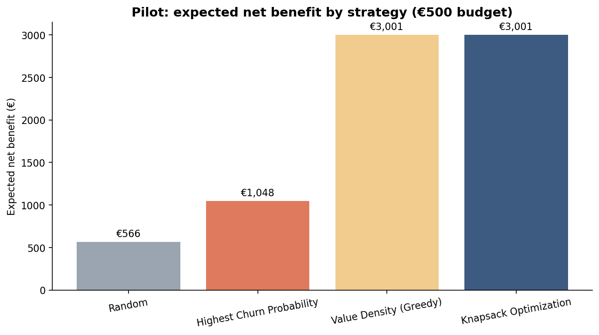
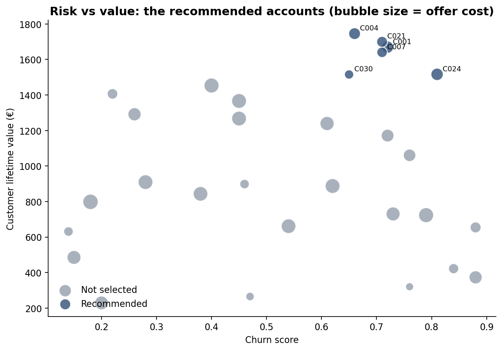
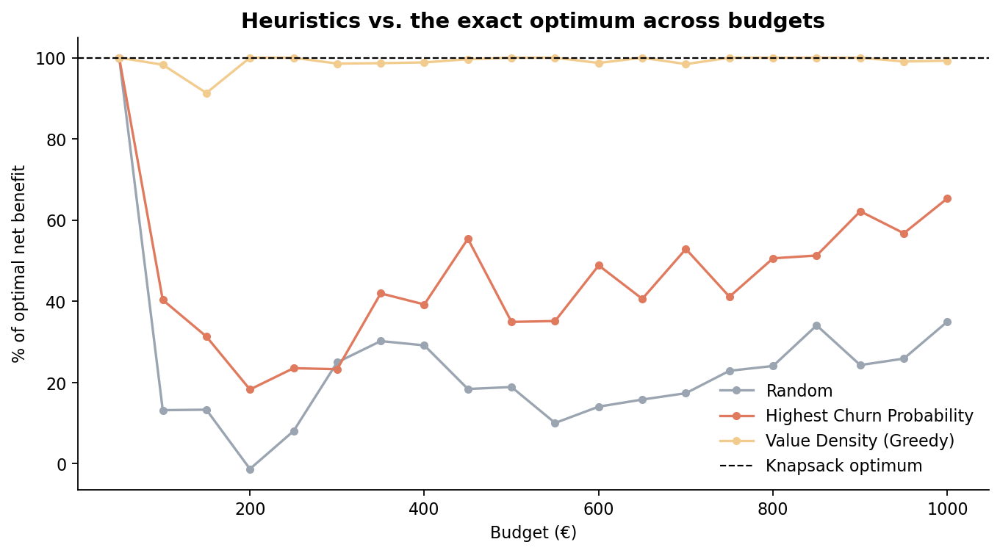
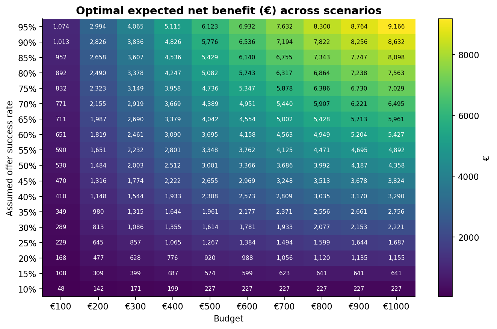
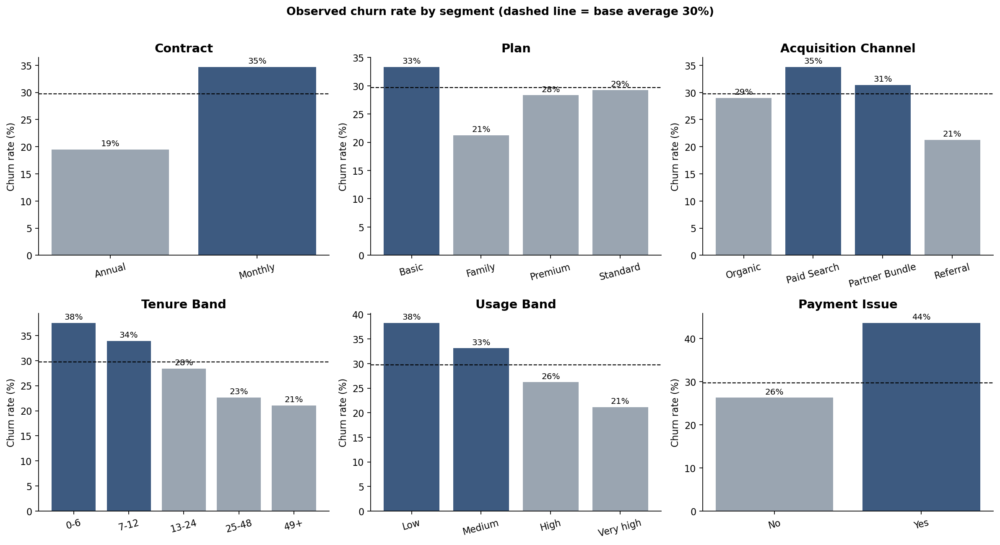
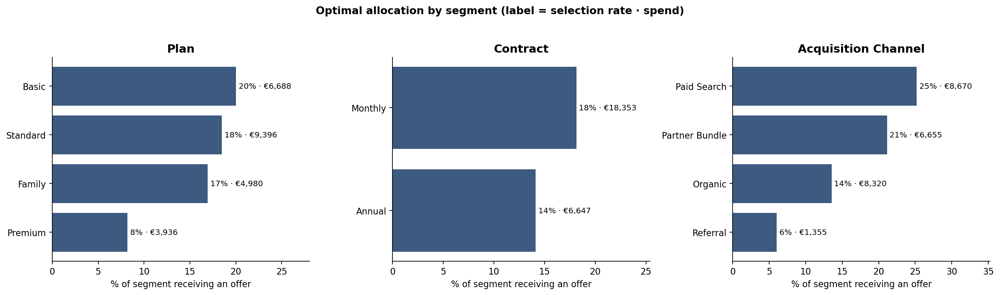
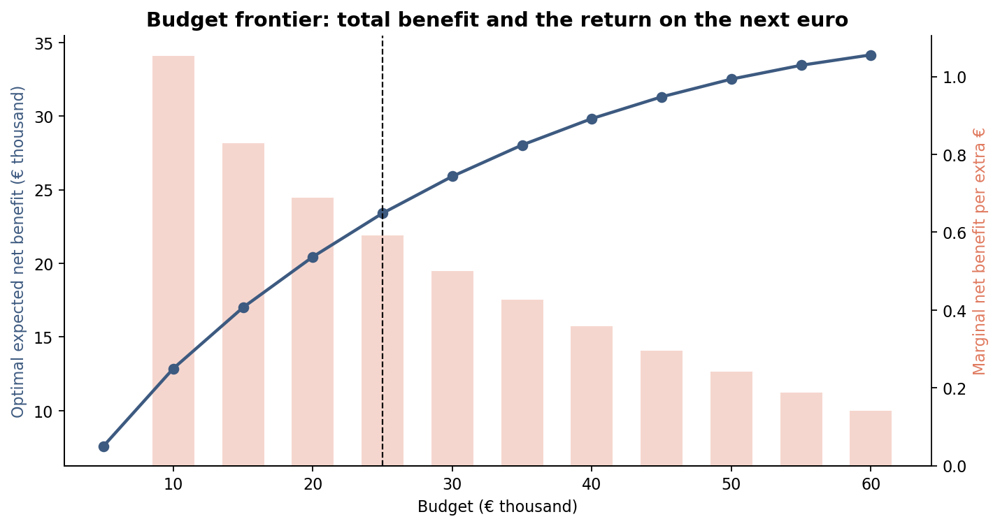
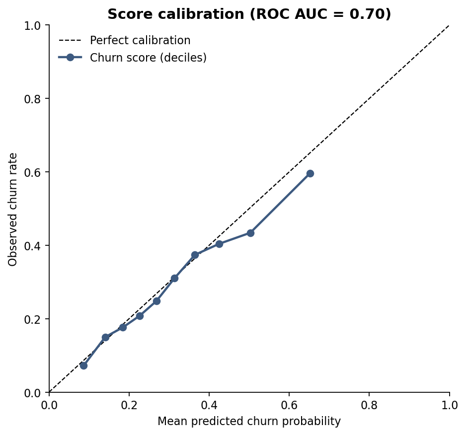

<div align="center">

# Project Odin

### Retention budget optimisation for a subscription business

**Which subscribers should receive a retention offer when the budget is fixed?**
Project Odin replaces "contact the riskiest customers first" with a provably optimal, value-based selection: a 0/1 Knapsack optimisation over churn risk, lifetime value and offer cost.

[](https://github.com/afroozmohandesian/churn-retention-optimizer/actions/workflows/ci.yml)


</div>

> **Case study.** The engagement is framed for **Aurvandil Media**, a *fictional* pan-European subscription streaming service. All data is synthetic and was generated for this project. No real customer data is used.

---

## Contents

- [Executive summary](#executive-summary)
- [The business problem](#the-business-problem)
- [Approach](#approach)
- [Findings](#findings)
- [Recommendations](#recommendations)
- [Quick start](#quick-start)
- [Repository structure](#repository-structure)
- [Data](#data)
- [Quality assurance](#quality-assurance)
- [Limitations](#limitations)
- [Roadmap](#roadmap)

---

## Executive summary

| Scope | Budget | Current rule (risk-first) | **Optimised portfolio** | Improvement |
|---|---:|---:|---:|---:|
| **Pilot**: 30 high-value accounts | €500 | €1,048 | **€3,001** | **2.9×** |
| **Full base**: 5,000 subscribers | €25,000 | €20,438 | **€23,405** | **+€2,967 (+15%)** |

<sub>Expected net benefit (retained value minus offer cost) at an assumed 50% offer success rate.</sub>

1. **Churn risk alone is the wrong target.** The best accounts combine above-average risk with high lifetime value and affordable offers.
2. **The solution is provably optimal and robust.** It is verified against exhaustive search, and the pilot portfolio is unchanged across every offer success rate from 10% to 95%.
3. **Lower risk.** The pilot's probability of a loss falls from 16.1% to 7.3%. On the full base, the optimised campaign is profitable in all 20,000 Monte Carlo scenarios, while random targeting loses money 36% of the time.
4. **Budget has diminishing returns.** At €25k, the next euro of budget returns about €0.59, down from €1.05 at €10k. This gives a quantitative basis for sizing the budget.
5. **Where the money goes.** Most of the budget goes to monthly contracts, Basic and Standard plans, and paid-search and partner-bundle acquisitions. Premium is targeted least because its offer rarely pays back, so the offer itself should be redesigned.

<p align="center">
  
  
</p>

📄 **Full report:** [`notebooks/Project_Odin_Report.ipynb`](notebooks/Project_Odin_Report.ipynb)

---

## The business problem

The client's retention team has a fixed quarterly budget and contacts the subscribers with the highest churn score first. That rule has three blind spots:

| Blind spot | Consequence |
|---|---|
| **Value**: a high-risk subscriber may be worth very little | Budget protects low-value accounts |
| **Cost**: offer prices differ by plan | Expensive saves crowd out cheap, high-value ones |
| **Combination**: one-at-a-time ranking ignores fit | Budget is left unused or spent on a sub-optimal mix |

The real decision is: **which *combination* of subscribers maximises expected net benefit within the budget?** That is the classic **0/1 Knapsack problem**.

---

## Approach

**Customer economics.** For churn score $P_i$, lifetime value $CLV_i$, offer cost $C_i$ and assumed offer success rate $r$:

$$
ERV_i = P_i \cdot CLV_i \cdot r
\qquad
ENB_i = ERV_i - C_i
\qquad
r^{*}_i = \frac{C_i}{P_i \cdot CLV_i}
$$

These are the expected retained value, the expected net benefit, and the break-even success rate.

**Portfolio optimisation.**

$$
\max_{x} \sum_i x_i\,ENB_i
\quad \text{s.t.} \quad
\sum_i x_i\,C_i \le B,
\qquad x_i \in \{0,1\}
$$

The model is solved exactly by dynamic programming in `O(n·B)`, vectorised with NumPy: **10,000 customers and a €50,000 budget in under a second**.

| Strategy | Rule | Role |
|---|---|---|
| Random | Seeded shuffle, take each subscriber whose cost still fits | Floor |
| Highest churn probability | Rank by score | **Client's current practice** |
| Value density (greedy) | Rank by ENB ÷ cost | Strong heuristic benchmark |
| **Knapsack (DP)** | Exact optimum | **Proposed** |

**Beyond the point estimate:**

- **Sensitivity:** a budget × success-rate grid, plus portfolio stability.
- **Monte Carlo:** the distribution of realised outcomes, percentiles and the probability of a loss.
- **Churn-score diagnostics:** ROC AUC, Brier score and a calibration curve.
- **Segment allocation:** where the budget goes by plan, contract, channel and region.
- **Budget frontier:** the marginal return on each additional euro.

---

## Findings

### Pilot: 30 high-value accounts, €500

| Strategy | Accounts | Spend | Expected net benefit | ROI | % of optimum | P(loss) |
|---|---:|---:|---:|---:|---:|---:|
| Random | 5 | €462 | €566 | 1.23× | 19% | 33.6% |
| Highest churn probability | 5 | €481 | €1,048 | 2.18× | 35% | 16.1% |
| Value density (greedy) | 6 | €467 | €3,001 | 6.43× | 100% | 7.3% |
| **Knapsack optimisation** | **6** | **€467** | **€3,001** | **6.43×** | **100%** | **7.3%** |

The recommended accounts are **C001, C004, C007, C021, C024, C030**. Greedy matches the optimum at €500, but across budgets from €50 to €1,000 it falls as low as **91.3%** of the optimum, and the risk-first rule falls to **18.3%**.

<p align="center">
  
  
</p>

### Full base: 5,000 subscribers, €25,000

| Strategy | Subscribers | Spend | Expected net benefit | ROI | % of optimum | P(loss) |
|---|---:|---:|---:|---:|---:|---:|
| Random | 769 | €24,989 | €901 | 0.04× | 3.9% | 36.1% |
| Highest churn probability | 843 | €24,995 | €20,438 | 0.82× | 87.3% | 0.0% |
| Value density (greedy) | 841 | €25,000 | €23,405 | 0.94× | 100% | 0.0% |
| **Knapsack optimisation** | **841** | **€25,000** | **€23,405** | **0.94×** | **100%** | **0.0%** |

<p align="center">
  
</p>

<p align="center">
  
</p>

<p align="center">
  
  
</p>

---

## Recommendations

1. **Adopt value-based optimisation** in place of risk-first targeting. It adds about €3,000 (+15%) per €25k campaign at no extra cost.
2. **Target the segments where risk, value and cost line up**, and **redesign the Premium offer**, which rarely pays back at its current cost.
3. **Measure the true offer effect** with a randomised 10–20% hold-out in the next campaign. The success rate is the single most important assumption.
4. **Size the budget with the frontier.** Fund up to the point where the marginal return per euro reaches the hurdle rate.
5. **Operationalise.** `python -m odin analyze` refreshes the target list from the latest scores each cycle.

---

## Quick start

```bash
git clone https://github.com/afroozmohandesian/churn-retention-optimizer.git
cd churn-retention-optimizer
python -m venv .venv && source .venv/bin/activate
pip install -e ".[dev]"
```

```bash
# Pilot analysis → outputs/
python -m odin analyze

# Full subscriber base → outputs/customer_base_5000/
python -m odin analyze --data data/synthetic/customer_base_5000.csv --budget 25000 --budget-scenarios 10000,25000,40000 --out outputs/customer_base_5000

# Your own assumptions
python -m odin analyze --budget 800 --success-rate 0.35 --out outputs/my_scenario

# Regenerate the synthetic subscriber base
python -m odin generate --n 5000 --seed 7 --out data/synthetic/customer_base_5000.csv
```

```python
from odin import load_customers, add_expected_value, knapsack_selection

customers = add_expected_value(load_customers("data/raw/project_odin_customers.csv"), success_rate=0.5)
knapsack_selection(customers, budget=500)
# ['C001', 'C004', 'C007', 'C021', 'C024', 'C030']
```

`make all` runs lint, tests, both analyses, the benchmark and the report notebook end to end.

---

## Repository structure

```text
churn-retention-optimizer/
├── notebooks/
│   └── Project_Odin_Report.ipynb       # client-style decision analytics report
├── data/
│   ├── raw/project_odin_customers.csv  # pilot cohort (30 accounts)
│   ├── synthetic/customer_base_5000.csv# full subscriber base (5,000 × 14 attributes)
│   └── README.md                       # data dictionary and generating process
├── src/odin/                           # tested, reusable package
│   ├── config.py        # scenario assumptions
│   ├── data.py          # loading and validation
│   ├── economics.py     # ERV, ENB, break-even rate
│   ├── strategies.py    # random, risk-first, greedy, knapsack DP, brute force
│   ├── offers.py        # offer catalogue and multiple-choice knapsack
│   ├── constraints.py   # contact capacity and segment quotas (integer programme)
│   ├── uplift.py        # randomised-experiment simulation, T-learner, Qini
│   ├── evaluation.py    # metrics, optimality gap, score diagnostics, segment allocation
│   ├── sensitivity.py   # one-way, two-way grid, portfolio stability
│   ├── simulation.py    # Monte Carlo risk
│   ├── synthetic.py     # reproducible data generators
│   ├── plots.py · pipeline.py · cli.py
├── scripts/
│   ├── benchmark.py                # heuristic gap and solver runtime
│   └── build_report_notebook.py    # report notebook kept as reviewable source
├── tests/                          # 67 pytest tests
├── outputs/
│   ├── report/                     # figures and tables from the report notebook
│   ├── customer_base_5000/         # CLI run on the full base
│   └── figures/ tables/ summary.txt# CLI run on the pilot
├── docs/methodology.md
└── .github/workflows/ci.yml        # lint and tests on Python 3.10–3.12
```

---

## Data

| Dataset | Rows | Attributes | Purpose |
|---|---:|---:|---|
| `data/raw/project_odin_customers.csv` | 30 | 5 | Pilot cohort. Every decision can be inspected and verified by brute force. |
| `data/synthetic/customer_base_5000.csv` | 5,000 | 14 | Full base, with plan, contract, region, channel, tenure, viewing hours, tickets and payment failures. |

The full-base churn score is generated from the behavioural drivers **with model error**, so it is informative but imperfect (ROC AUC 0.70), like a real churn model. CLV is margin-based. Offer costs are plan-specific. See [`data/README.md`](data/README.md).

---

## Quality assurance

- **67 tests** (`pytest`), lint and format checks (`ruff`), and CI on Python 3.10, 3.11 and 3.12.
- The DP solver is checked against **exhaustive search** on 25 random instances, plus a counter-example where greedy is sub-optimal.
- Budget feasibility, **monotone sensitivity**, **Monte Carlo convergence** to the analytical expectation, data-validation rules and the CLI end to end are all tested.
- The report notebook is generated from [`scripts/build_report_notebook.py`](scripts/build_report_notebook.py) and calls the same package as the CLI, so the numbers always agree.

---

## Limitations

- **Synthetic data and a fictional client.** The results demonstrate the method. They are not measured business outcomes.
- **Assumed offer effectiveness.** The 50% success rate is stress-tested from 10% to 95% but is not estimated from data.
- **Simplified economics.** CLV is undiscounted, and partial retention and cannibalisation are not modelled.
- **No causal claim.** Causal impact requires a randomised hold-out (Recommendation 3).

Full detail: [`docs/methodology.md`](docs/methodology.md).

---

## Roadmap

- [x] Uplift modelling: per-subscriber treatment effects instead of a single success rate: `odin.uplift`
- [x] Several offer types per subscriber (multiple-choice knapsack): `odin.offers`
- [x] Contact-capacity and segment-quota constraints (integer programme with HiGHS): `odin.constraints`
- [ ] Interactive scenario explorer (Streamlit)

---

<sub>Released under the [MIT License](LICENSE).</sub>
